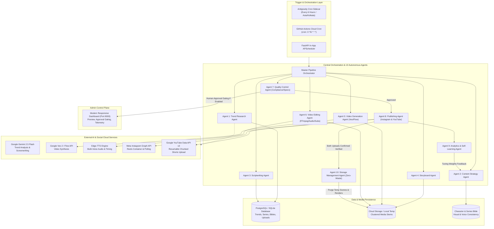

# Autonomous AI Viral Reels & YouTube Shorts Automation Platform
## Complete Technical Specification, Architecture Blueprint & Operating Guide

---

## 1. Executive Summary

The **Autonomous AI Viral Reels & YouTube Shorts Automation Platform** is an enterprise-grade, cloud-native automated media production and distribution engine. It functions as an autonomous AI media house that continuously and independently:

1. **Discovers Viral Trends**: Analyzes high-engagement short-form video patterns across Instagram Reels, YouTube Shorts, and Google Trends without copying copyrighted content.
2. **Plans Episodic Mini-Series**: Groups original concepts into continuous multi-part story arcs with consistent characters and cliffhangers using a persistent **Character Bible**.
3. **Authors High-Retention Scripts**: Generates vertical (9:16) scripts structured around strong 1–3 second opening hooks, rapid narrative pacing, and suspense escalation.
4. **Directs Scene Storyboards**: Translates scripts into 3–4 visual scenes with cinematic camera angles, lighting directions, and generation prompts optimized for **Google Veo 2 / Flow**.
5. **Generates AI Video Clips**: Synthesizes photorealistic vertical video scenes using Google Veo 2 / Flow models (with an integrated high-fidelity sandbox simulator).
6. **Edits & Composites Videos**: Synthesizes natural character voiceovers via Edge-TTS, burns in word-level animated subtitles (ASS/SRT styling), and composites 1080x1920 MP4 masters using FFmpeg with EBU R128 audio loudness normalization.
7. **Automated Quality Control**: Validates video dimensions, frame rates, audio clarity, and policy compliance, with configurable Human-in-the-Loop gating.
8. **Multi-Platform Cloud Publishing**: Uploads directly to **Meta Instagram Reels** (via Instagram Graph API) and **YouTube Shorts** (via YouTube Data API v3 resumable chunked streaming).
9. **Zero-Waste Storage Optimization**: Automatically purges intermediate scene clips and master renders *only after verified successful uploads on all target platforms*.
10. **Analytics & Self-Learning**: Gathers view counts, retention curves, and share ratios to tune future script hooks, themes, and pacing.

The platform runs 100% in the cloud via **GitHub Actions** and **FastAPI**, operating completely independently of your personal computer.

---

## 2. End-to-End System Architecture



---

## 3. The 10 Autonomous AI Agents

| Agent | Responsibility | Core Mechanics & Logic |
| :--- | :--- | :--- |
| **Agent 1: Trend Research Agent** | Mines viral hooks and storytelling formats from social platforms and Google Trends. | Calculates a composite **Virality Score** (0–100) based on Growth Rate, Engagement, Relevance, Competition, and Reusability. Deduplicates topics in the database to prevent duplicate research. |
| **Agent 2: Content Strategy Agent** | Selects winning trends, schedules episodic series, and enforces continuity. | Maintains the **Character Bible** (visual descriptions, voice pitch, rate, and character roles) to ensure identical character looks and voices across multi-part series. |
| **Agent 3: Scriptwriting Agent** | Authors viral 30–60 second micro-cinema scripts. | Paces the story into 4 distinct phases: **0–3s** Scroll-stopping hook, **3–15s** Mystery introduction, **15–35s** Tension escalation, and **35–45s** Shocking cliffhanger. |
| **Agent 4: Storyboard Agent** | Converts scripts into scene-by-scene prompts for Google Veo. | Specifies camera movement (macro, Dutch angle, push-in), 9:16 vertical framing, environmental lighting (volumetric rim light, amber shadows), and negative prompts. |
| **Agent 5: Video Generation Agent** | Synthesizes scene video clips via Google Veo 2 / Flow API. | Handles aspect ratio enforcement (9:16), clip duration, retries, and high-fidelity fallback simulation with automated frame rendering. |
| **Agent 6: Video Editing Agent** | Composites scene clips, voiceovers, dynamic subtitles, and audio. | Generates character voiceover via Edge-TTS, creates word-level synchronized animated ASS/SRT subtitles (yellow highlight, bold uppercase), and normalizes audio to EBU R128 standards. |
| **Agent 7: Quality Control Agent** | Inspects video specs and enforces policy safety. | Validates 1080x1920 vertical resolution, checks audio levels and duration limits, and enforces **Human-in-the-Loop Gating** before publishing. |
| **Agent 8: Publishing Agent** | Publishes verified content to Instagram Reels and YouTube Shorts. | Manages Meta Instagram container polling (`media_type=REELS`) and Google YouTube Data API resumable chunked streaming with automatic `#Shorts` tagging. |
| **Agent 9: Analytics & Self-Learning Agent** | Analyzes video performance telemetry and updates strategy weights. | Tracks views, watch time, completion rates, and shares. Feeds top-performing hook structures back into the Content Strategy Agent. |
| **Agent 10: Storage Management Agent** | Guarantees zero orphaned cloud storage. | Implements a **strict two-phase commit deletion policy**: deletes raw scene clips and master renders only after verified dual-platform publishing. |

---

## 4. Zero-Waste Storage Optimization Protocol

To eliminate storage clutter and unnecessary cloud costs, the platform implements a strict storage lifecycle:

```
[Scene Clips Generated] ──► Saved to ./data/media/scenes/episode_X/*.mp4
         │
         ▼
[Video Assembly & Subs] ──► Saved to ./data/media/renders/episode_X_master.mp4
         │
         ▼
[Automated QC & Approval] ──► Passed Checks
         │
         ▼
[Publish to Instagram Reels] ──┐
                               ├──► Both Verified? ──► YES ──► Delete ./data/media/scenes/*
[Publish to YouTube Shorts]  ──┘                                Delete ./data/media/renders/*
                                                                Preserve Metadata & URLs in DB
                                                   ──► NO  ──► Retain master for retry
```

### Safety Rules:
- **Two-Phase Verification**: Video files are **never deleted** until both Instagram and YouTube return verified live post IDs and URLs.
- **Retry Preservation**: If one platform fails, the final rendered video is preserved for retry without re-rendering.
- **Permanent Metadata**: Scripts, prompts, character descriptions, and published live URLs remain permanently stored in the database.

---

## 5. Database Schema & Data Models

The system supports SQLite (local execution) and PostgreSQL (cloud production) through SQLAlchemy:

### `viral_trends` Table
- `id` (Integer, Primary Key)
- `topic` (String 255, Indexed)
- `niche` (String 100, Indexed)
- `source_platform` (String 50: `instagram`, `youtube`, `mixed`)
- `hook_3s` (Text)
- `storytelling_technique` (String 255)
- `estimated_duration_sec` (Integer)
- `editing_style` (String 255)
- `audio_trend` (String 255)
- `virality_score` (Float, 0.0–100.0)
- `status` (String 50: `discovered`, `selected`, `converted`, `archived`)
- `discovered_at` (DateTime)

### `series` Table
- `id` (Integer, Primary Key)
- `title` (String 255, Unique, Indexed)
- `niche` (String 100)
- `theme` (Text)
- `target_audience` (String 255)
- `total_episodes_planned` (Integer)
- `current_episode_count` (Integer)
- `continuity_notes` (Text)
- `created_at` (DateTime)

### `character_bible` Table
- `id` (Integer, Primary Key)
- `series_id` (Integer, Foreign Key -> `series.id`)
- `name` (String 100)
- `role` (String 100: `protagonist`, `antagonist`, `narrator`)
- `visual_description` (Text — Used for consistent Veo generation)
- `voice_name` (String 100: e.g. `en-US-ChristopherNeural`)
- `voice_pitch` (String 20)
- `voice_rate` (String 20)
- `personality_traits` (Text)

### `episodes` Table
- `id` (Integer, Primary Key)
- `series_id` (Integer, Foreign Key -> `series.id`)
- `episode_number` (Integer)
- `title` (String 255)
- `synopsis` (Text)
- `hook_3s` (Text)
- `cliffhanger` (Text)
- `full_script` (Text)
- `target_duration_sec` (Integer)
- `actual_duration_sec` (Integer)
- `aspect_ratio` (String 20: `9:16`)
- `resolution` (String 20: `1080x1920`)
- `video_path` (String 512)
- `audio_path` (String 512)
- `subtitles_path` (String 512)
- `status` (String 50: `draft`, `scripted`, `generating`, `editing`, `pending_approval`, `approved`, `publishing`, `published`)
- `requires_approval` (Boolean)
- `is_approved` (Boolean)
- `scheduled_publish_time` (DateTime)
- `published_at` (DateTime)
- `created_at` (DateTime)

### `scenes` Table
- `id` (Integer, Primary Key)
- `episode_id` (Integer, Foreign Key -> `episodes.id`)
- `scene_number` (Integer)
- `scene_description` (Text)
- `camera_angle` (String 100)
- `character_name` (String 100)
- `character_actions` (Text)
- `dialogue` (Text)
- `environment` (Text)
- `lighting` (String 255)
- `visual_style` (String 255)
- `sound_effects` (String 255)
- `duration_seconds` (Float)
- `veo_prompt` (Text)
- `clip_path` (String 512)
- `status` (String 50: `pending`, `generating`, `ready`, `failed`)

### `publish_jobs` Table
- `id` (Integer, Primary Key)
- `episode_id` (Integer, Foreign Key -> `episodes.id`)
- `platform` (String 50: `instagram`, `youtube`)
- `title` (String 255)
- `caption` (Text)
- `hashtags` (Text)
- `status` (String 50: `queued`, `processing`, `uploaded`, `verified`, `failed`)
- `platform_post_id` (String 255)
- `platform_url` (String 512)
- `is_verified_published` (Boolean)
- `verified_at` (DateTime)
- `created_at` (DateTime)

### `analytics_records` Table
- `id` (Integer, Primary Key)
- `episode_id` (Integer, Foreign Key -> `episodes.id`)
- `platform` (String 50)
- `views` (Integer)
- `likes` (Integer)
- `comments` (Integer)
- `shares` (Integer)
- `saves` (Integer)
- `avg_watch_time_sec` (Float)
- `retention_rate_pct` (Float)
- `completion_rate_pct` (Float)
- `engagement_rate_pct` (Float)
- `recorded_at` (DateTime)

### `strategy_feedback` Table
- `id` (Integer, Primary Key)
- `niche` (String 100)
- `winning_hook_formats` (Text)
- `optimal_duration_sec` (Integer)
- `top_performing_styles` (Text)
- `summary_learnings` (Text)
- `updated_at` (DateTime)

---

## 6. Interactive Admin Web Dashboard

The platform includes a built-in interactive dashboard served directly at `http://localhost:8000`:

- **Production Pipeline & Approvals Tab**: View episodes progressing across states (`draft` -> `scripted` -> `generating` -> `editing` -> `pending_approval` -> `published`). Includes a built-in 9:16 vertical video player and **Approve & Publish** buttons.
- **Viral Trends Engine Tab**: Discover and inspect trending hooks, editing styles, and psychological drivers ranked by Virality Score.
- **Series & Character Bible Tab**: View multi-part series, character descriptions, and vocal profiles.
- **Publishing & Accounts Tab**: Monitor connection status for Meta Instagram Graph API and Google YouTube Data API v3.
- **Self-Learning & Analytics Tab**: Real-time telemetry monitoring views, retention rates, and AI feedback learnings.
- **Cloud & Storage Settings Tab**: Configure manual approval requirements, video durations, and zero-waste storage auto-cleanup.

---

## 7. Cloud Workflows & GitHub Actions (100% Cloud-Operated)

All workflows are located in `.github/workflows/`:

### 1. `autonomous_scheduler.yml` — Cloud Content Factory
- **Schedule**: Automatically runs every 6 hours via GitHub cron (`cron: '0 */6 * * *'`).
- **On-Demand Dispatch**: Can be triggered manually from the GitHub Actions UI with custom options:
  - `niche`: Dropdown with `sci-fi and mystery`, `horror stories`, `educational micro-content`, `interesting facts`, etc.
  - `auto_publish`: `true` to immediately publish, or `false` to hold for approval.
  - `duration`: Target video duration in seconds (30–60s).
- **Execution**: Spins up an Ubuntu runner, installs FFmpeg, runs `backend/cli.py`, executes all 10 agents, and writes a generation report to the **GitHub Actions Job Summary**.

### 2. `ci.yml` — Continuous Integration & Verification
- Triggers on every `push` and `pull_request` to `main`.
- Sets up Python 3.11, installs system FFmpeg, and executes the full Pytest test suite.

### 3. `cloud_run_deploy.yml` — Serverless GCP Cloud Run Deployment
- Automatically builds the Docker container and deploys the FastAPI backend and web dashboard to Google Cloud Run upon commits to `main`.

---

## 8. Setup, Installation & Launchers

### Quick Start with Provided Scripts:
- **`start_studio.bat`**: Double-click to start the local FastAPI web server & dashboard at `http://localhost:8000`.
- **`run_cycle.bat`**: Double-click to execute one complete autonomous cycle from the command line.
- **`push_to_github.py`**: Pure-Python GitHub pusher that commits and pushes to GitHub without needing `git.exe` installed on Windows.

### Manual Setup via Terminal:
```bash
# 1. Clone & enter repository
cd viral-reels-automation

# 2. Activate virtual environment
# Windows:
.venv\Scripts\activate
# Linux/macOS:
source .venv/bin/activate

# 3. Install dependencies
pip install -r requirements.txt

# 4. Start Studio Dashboard
python -m uvicorn backend.app.main:app --host 0.0.0.0 --port 8000 --reload
```

### Running Tests:
```bash
pytest tests/ -v
```

---

## 9. External API Credentials Reference

| Environment Variable | Service | How to Obtain | Purpose |
| :--- | :--- | :--- | :--- |
| `GEMINI_API_KEY` | Google AI Studio | Free at [aistudio.google.com](https://aistudio.google.com/) | Scriptwriting, trend scoring, and storyboard generation |
| `GOOGLE_GENAI_API_KEY` | Google AI Studio | Free at [aistudio.google.com](https://aistudio.google.com/) | Powers Google Veo 2 video synthesis |
| `VEO_SIMULATION_MODE` | Internal Engine | Set `true` for free sandbox; `false` for live Veo | Controls whether live Veo 2 endpoints or local synthesis is used |
| `INSTAGRAM_ACCOUNT_ID` | Meta for Developers | [developers.facebook.com](https://developers.facebook.com/) | Instagram Professional (Creator/Business) account identifier |
| `INSTAGRAM_ACCESS_TOKEN` | Meta Graph API Explorer | [developers.facebook.com/tools/explorer](https://developers.facebook.com/tools/explorer/) | Long-lived Page Access Token with `instagram_content_publish` |
| `YOUTUBE_CLIENT_ID` | Google Cloud Console | [console.cloud.google.com](https://console.cloud.google.com/) | OAuth 2.0 Client ID for YouTube Data API v3 |
| `YOUTUBE_CLIENT_SECRET` | Google Cloud Console | [console.cloud.google.com](https://console.cloud.google.com/) | OAuth 2.0 Client Secret |
| `YOUTUBE_REFRESH_TOKEN` | Google OAuth Playground | [developers.google.com/oauthplayground](https://developers.google.com/oauthplayground/) | Scope: `https://www.googleapis.com/auth/youtube.upload` |
