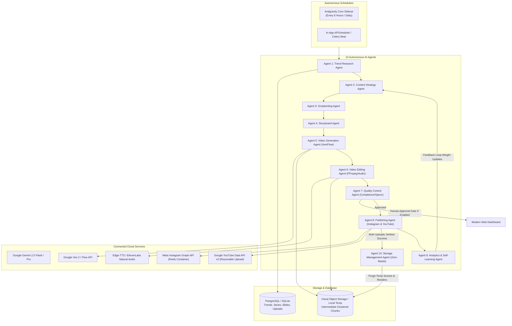

# Autonomous AI Viral Reels & YouTube Shorts Automation Platform

A production-grade, cloud-native automated media factory designed to independently discover viral video trends, research successful Instagram Reels and YouTube Shorts, generate original episodic AI mini-series inspired by those trends, synthesize video clips using Google Flow / Veo 2, dynamically edit and subtitle them into vertical 9:16 content, and publish them automatically to Instagram Reels and YouTube Shorts with zero-waste cloud storage optimization.

---

## 1. System Architecture



---

## 2. The 10 Autonomous Agents

| Agent | Responsibility | Key Mechanics |
| :--- | :--- | :--- |
| **1. Trend Research Agent** | Mines viral hooks and storytelling formats across Reels, Shorts & Google Trends. | Calculates composite Virality Score (Growth, Engagement, Competition). Deduplicates against DB. |
| **2. Content Strategy Agent** | Selects high-potential niches and plans multi-part episodic continuity. | Maintains the **Character Bible** (appearance, voice, personality) across episodes. |
| **3. Scriptwriting Agent** | Authors high-retention 30–60s scripts with powerful 1-3s hooks and cliffhangers. | Formatted for rapid scene transitions and curiosity gaps. |
| **4. Storyboard Agent** | Translates scripts into 3-4 visual scenes with 9:16 Google Veo prompts. | Specifies camera angle, motion, lighting, character continuity, and negative prompts. |
| **5. Video Generation Agent** | Synthesizes scene clips using Google Veo 2 / Flow API. | Handles aspect ratio (9:16), duration, retries, and high-fidelity fallback simulator. |
| **6. Video Editing Agent** | Composites scene clips, generates voiceover & dynamic animated subtitles. | Uses Edge-TTS (multi-character voices) and FFmpeg/EBU R128 audio normalization. |
| **7. Quality Control Agent** | Validates technical video specifications and platform policy safety. | Enforces Human-in-the-Loop approval gating before publishing. |
| **8. Publishing Agent** | Orchestrates verified uploads to Instagram Reels and YouTube Shorts. | Official Instagram Graph API (container polling) & YouTube Data API (resumable chunked upload). |
| **9. Analytics Agent** | Pulls performance telemetry (views, shares, retention) and updates strategy weights. | Self-learning loop tuning opening hooks and optimal durations. |
| **10. Storage Management Agent** | Guarantees zero orphaned cloud storage. | **Strict verification protocol**: Only purges raw scene clips and intermediate renders after confirmed uploads on both platforms. |

---

## 3. Storage Optimization Protocol (Zero-Waste)

To prevent ballooning cloud object storage bills, the platform implements a two-phase commit deletion policy:
1. **Generation**: Raw scene clips (`scene_1.mp4`, `scene_2.mp4`) are generated in temporary storage.
2. **Assembly**: Master 9:16 video (`episode_X_master.mp4`) is rendered. Intermediate scenes are purged.
3. **Publishing**: Master video is uploaded to Instagram Reels and YouTube Shorts.
4. **Verification**: If and only if BOTH platforms return verified permalinks and post IDs:
   - Intermediate stems, subtitle files, and master render files are permanently deleted.
   - All metadata, scripts, prompts, character bibles, and live post URLs remain permanently preserved in PostgreSQL/SQLite.
5. **Safety Guarantee**: If one platform fails, the master video is retained for retry.

---

## 4. Setup & Installation

### Prerequisites
- Python 3.10+ (Tested on Python 3.11 and 3.13)
- Node.js & Docker (optional for container deployment)
- FFmpeg (system install or auto-resolved via `imageio-ffmpeg`)

### 1. Clone & Setup Virtual Environment
```bash
git clone <repo-url> viral-reels-automation
cd viral-reels-automation

python -m venv .venv
# Windows:
.venv\Scripts\activate
# Linux/macOS:
source .venv/bin/activate

pip install -r requirements.txt
```

### 2. Configure Environment Variables
Copy `.env.example` to `.env`:
```bash
cp .env.example .env
```
Key configuration parameters:
- `GEMINI_API_KEY`: Google Gemini API key for scriptwriting and trend intelligence.
- `GOOGLE_GENAI_API_KEY`: Google GenAI API key for Veo 2 video generation.
- `VEO_SIMULATION_MODE`: Set to `true` for offline development/sandbox testing; `false` to invoke live Google Veo endpoints.
- `INSTAGRAM_ACCOUNT_ID` & `INSTAGRAM_ACCESS_TOKEN`: Meta Instagram Professional account credentials.
- `YOUTUBE_CLIENT_ID`, `YOUTUBE_CLIENT_SECRET`, `YOUTUBE_REFRESH_TOKEN`: Google YouTube OAuth2 credentials.
- `REQUIRE_MANUAL_APPROVAL`: Set to `true` to require manual sign-off in the dashboard before publishing.

### 3. Run Application
```bash
python -m uvicorn backend.app.main:app --host 0.0.0.0 --port 8000 --reload
```
Open **http://localhost:8000** in your browser to access the interactive web dashboard.

---

## 5. API Setup Instructions

### Google Veo 2 / Flow API
1. Visit [Google AI Studio](https://aistudio.google.com/) or [Google Cloud Vertex AI](https://console.cloud.google.com/vertex-ai).
2. Generate an API Key with access to Google GenAI video models (`veo-2.0-generate-001`).
3. Set `GOOGLE_GENAI_API_KEY` in `.env` and configure `VEO_SIMULATION_MODE=false`.

### Meta Instagram Graph API (Reels Publishing)
1. Convert your Instagram account to an **Instagram Professional (Creator or Business) Account**.
2. Connect your Instagram account to a **Facebook Page**.
3. Create an app in the [Meta for Developers Portal](https://developers.facebook.com/).
4. Add the **Instagram Graph API** product.
5. Request permissions: `instagram_basic`, `instagram_content_publish`, `pages_show_list`, `pages_read_engagement`.
6. Generate a Never-Expiring Long-Lived User Access Token and populate `INSTAGRAM_ACCESS_TOKEN` and `INSTAGRAM_ACCOUNT_ID`.

### Google YouTube Data API v3 (Shorts Publishing)
1. Go to the [Google Cloud Console](https://console.cloud.google.com/).
2. Enable the **YouTube Data API v3**.
3. Create an **OAuth 2.0 Client ID** (Application Type: Web Application).
4. Authorized Redirect URI: `http://localhost:8000/api/auth/youtube/callback` or OAuth Playground.
5. Scope required: `https://www.googleapis.com/auth/youtube.upload`.
6. Acquire a refresh token and set `YOUTUBE_CLIENT_ID`, `YOUTUBE_CLIENT_SECRET`, and `YOUTUBE_REFRESH_TOKEN`.

---

## 6. Docker & Cloud Deployment

### Run with Docker Compose
```bash
docker-compose up -d
```
Starts:
- FastAPI Backend & Web Dashboard on `http://localhost:8000`
- PostgreSQL Database on `localhost:5432`
- Redis Queue Broker on `localhost:6379`

---

## 7. Automated Testing
Run the automated test suite verifying all 10 agents, pipeline orchestration, and zero-waste storage guards:
```bash
pytest tests/ -v
```

---

## 8. GitHub Actions Cloud Automation (100% Cloud-Operated)

The platform includes production GitHub Actions workflows located in [`.github/workflows/`](file:///C:/Users/HP/.gemini/antigravity/scratch/viral-reels-automation/.github/workflows/):

### 1. Autonomous Scheduled Content Factory (`autonomous_scheduler.yml`)
- **Schedule**: Executes automatically every 6 hours (`cron: '0 */6 * * *'`) in GitHub Cloud Runners without requiring your personal computer to be switched on.
- **On-Demand Dispatch**: Can be triggered manually from the GitHub Actions UI with custom parameters:
  - `niche`: e.g. `sci-fi and mystery`, `horror stories`, `educational micro-content`, `interesting facts`
  - `auto_publish`: `true` to immediately publish to Instagram & YouTube, or `false` to hold for approval
  - `duration`: Target duration in seconds (30–60s)
- **Zero-Waste**: Automatically purges temporary render stems after verified uploads and publishes a rich visual summary to the GitHub Actions Job Summary.

### 2. Continuous Integration & Verification (`ci.yml`)
- Automatically triggers on every `push` and `pull_request`.
- Spins up Ubuntu runner, installs FFmpeg, installs dependencies, and runs the full pytest test suite.

### 3. Serverless Deployment to Google Cloud Run (`cloud_run_deploy.yml`)
- Deploys the FastAPI backend and web dashboard directly to GCP Cloud Run upon commits to `main`.

### Required GitHub Repository Secrets
Navigate to **Settings > Secrets and variables > Actions > New repository secret** and add:
- `GEMINI_API_KEY`
- `GOOGLE_GENAI_API_KEY`
- `INSTAGRAM_ACCOUNT_ID`
- `INSTAGRAM_ACCESS_TOKEN`
- `YOUTUBE_CLIENT_ID`
- `YOUTUBE_CLIENT_SECRET`
- `YOUTUBE_REFRESH_TOKEN`
- `VEO_SIMULATION_MODE` (Set to `false` for live Veo 2 generation)
